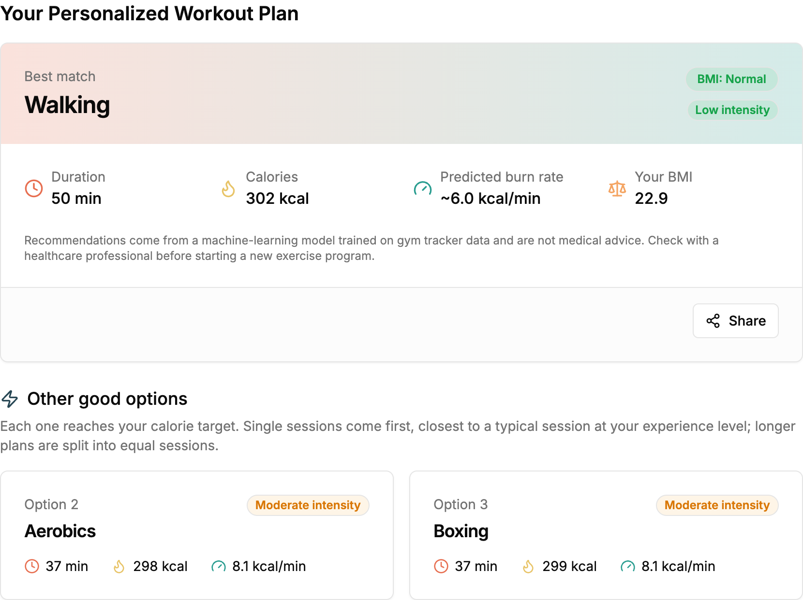

# FitSense-AI

**Personalized workout recommendations from a machine-learning model trained on real gym-tracker data.**

Enter your age, gender, height, weight, experience level and how many calories you want to burn. FitSense-AI returns the three workouts that best fit that goal, with the time, calories and intensity of each.

- **Live app:** https://fitsense-pi.vercel.app
- **API:** https://fitsense-api-production.up.railway.app/health
- **Data science & model training:** [FitInsights](https://github.com/minierks/FitInsights)



---

## How it works

FitSense is the serving side of a two-part project:

| Part | What it does | Where |
|---|---|---|
| **FitInsights** | Cleans the gym-tracker dataset, runs EDA and hypothesis tests, trains and exports the model | Jupyter notebooks |
| **FitSense** (this repo) | Serves the exported model through an API and a web app | Flask API + Next.js |

```
┌──────────────────────────┐   POST /predict    ┌──────────────────────────────────────────┐
│ project/  (Next.js)      │ ─────────────────► │ ml-api/  (Flask)                          │
│                          │  age, gender,      │                                           │
│ Form: react-hook-form    │  weight, height,   │ 1. Validate input, compute BMI            │
│       + zod validation   │  experience_level, │ 2. Predict kcal/min for all 14 workouts   │
│                          │  target_calories   │    (calorie-rate model, .joblib)          │
│ Result: best match +     │ ◄───────────────── │ 3. minutes = target ÷ kcal/min            │
│ 2 alternatives           │  top 3 plans       │ 4. Apply rules, rank, return top 3        │
└──────────────────────────┘                    └──────────────────────────────────────────┘
```

### The model

The model predicts **how many calories per minute** a person will burn in a given workout, from their profile:

- **Inputs:** age, weight, BMI, gender, experience level, workout type.
- **Model:** gradient boosting (`HistGradientBoostingRegressor`) inside a scikit-learn `Pipeline`, so preprocessing and model ship as one file.
- **Quality on held-out data:** R² = **0.86**, average error **0.8 kcal/min**. Predicted total calories are within about **8%** of the real value.

### From prediction to recommendation

For each request the API:

1. Predicts the burn rate for **all 14 workout types** and computes `minutes = target ÷ rate`.
2. **Excludes HIIT and CrossFit for beginners.** This is a safety rule, not something learned from the data.
3. **Splits** any plan longer than the longest session in the data (~70 min) into equal sessions, e.g. `2 × 37 min`.
4. **Ranks** plans that fit in one session first, by how close they are to the usual session length for the user's experience level. Split plans come after, least total time first.

Targets are limited to **100–800 kcal**, because no session in the training data burned more than ~806 kcal.

➡️ Full details, results and limitations: **[docs/model.md](docs/model.md)**

### Why not predict the workout type directly?

The first version used a Random Forest **classifier** to predict which workout a person "should" do. Measured properly, it reached **~18% accuracy across 14 workouts, against ~15% for always guessing the most common one**. The data shows that people doing different workouts have almost identical age and BMI, so body measurements can't predict workout choice.

The current model asks a question the data *can* answer: *"how fast would this person burn calories in each workout?"* That model explains 86% of the variation. See [docs/model.md](docs/model.md#1-why-the-first-version-was-replaced).

---

## Tech stack

| Layer | Tools |
|---|---|
| Frontend | Next.js 15 (App Router, static export), React 18, TypeScript, Tailwind CSS, shadcn/ui (Radix), react-hook-form + zod |
| API | Flask, flask-cors, gunicorn |
| ML | scikit-learn 1.9.1, pandas, NumPy, joblib |
| Testing | pytest (32 API tests) |
| Hosting | Vercel (frontend), Railway (API) |

---

## Repository structure

```
FitSense/
├── README.md
├── docs/
│   ├── model.md            # model, results, recommendation rules, limitations
│   ├── development.md      # run locally, tests, manual test checklist
│   ├── deployment.md       # Railway + Vercel deployment and troubleshooting
│   └── images/
├── ml-api/                 # Flask API
│   ├── app.py              # validation, recommendation logic, /predict and /health
│   ├── fitinsight_calorie_rate_model.joblib   # trained pipeline (from FitInsights)
│   ├── workout_profiles.json                  # intensity per workout, typical session lengths
│   ├── tests/test_app.py
│   ├── requirements.txt / requirements-dev.txt
│   ├── Procfile, .python-version              # deployment config
│   └── readme.md           # API reference
└── project/                # Next.js frontend
    ├── app/                # layout.tsx, page.tsx, globals.css
    ├── components/         # workout-form.tsx, workout-result.tsx, page sections, ui/
    ├── lib/mock-data.ts    # API response types + sample response for offline UI work
    └── .env.example
```

`ml-api/fitinsight_workout_model.joblib` and `fitinsight_seesion_model.joblib` are the first-version models. They are kept for reference but are no longer loaded.

---

## Quick start

You need Python 3.11+ and Node.js 20+.

```bash
# Terminal 1 — API on http://localhost:5001
cd ml-api
python3 -m venv .venv && source .venv/bin/activate
pip install -r requirements-dev.txt
pytest            # 32 tests
python app.py

# Terminal 2 — website on http://localhost:3000
cd project
npm install
cp .env.example .env.local      # NEXT_PUBLIC_API_URL=http://localhost:5001
npm run dev                     # on Node 25: NODE_OPTIONS=--no-experimental-webstorage npm run dev
```

➡️ More, including a manual test checklist: **[docs/development.md](docs/development.md)**

---

## API

`POST /predict`

```json
{ "age": 25, "gender": "Male", "weight": 70, "height": 175,
  "experience_level": "Intermediate", "target_calories": 300 }
```

returns the top 3 plans:

```json
{
  "recommended_workout": "Walking",
  "recommended_duration": 50,
  "expected_calorie_burn": 302,
  "recommendations": [
    {"workout": "Walking",  "sessions": 1, "minutes_per_session": 50, "duration_minutes": 50, "calories_per_minute": 6.0, "expected_calorie_burn": 302, "intensity": "Low"},
    {"workout": "Aerobics", "sessions": 1, "minutes_per_session": 37, "duration_minutes": 37, "calories_per_minute": 8.1, "expected_calorie_burn": 298, "intensity": "Moderate"},
    {"workout": "Boxing",   "sessions": 1, "minutes_per_session": 37, "duration_minutes": 37, "calories_per_minute": 8.1, "expected_calorie_burn": 299, "intensity": "Moderate"}
  ],
  "bmi": 22.9,
  "bmi_category": "Normal",
  "model_version": "calorie-rate-v1"
}
```

| Field | Allowed values |
|---|---|
| `age` | whole number, 16–90 |
| `gender` | `Male`, `Female`, `Non-binary` |
| `weight` | 30–250 kg |
| `height` | 120–250 cm |
| `experience_level` | `Beginner`, `Intermediate`, `Advanced`, `Professional` |
| `target_calories` | 100–800 |

Invalid input returns `400` with a message such as `{"error": "'target_calories' must be between 100 and 800"}`. `GET /health` returns the status and model version.

➡️ Full reference: **[ml-api/readme.md](ml-api/readme.md)**

---

## Deployment

| Part | Host | Deployed with |
|---|---|---|
| API | Railway | `railway up` from `ml-api/` |
| Website | Vercel | `npx vercel --prod` from `project/` |

The website finds the API through `NEXT_PUBLIC_API_URL`, which is fixed at build time. The API only accepts browser requests from the origins listed in `ALLOWED_ORIGINS`.

➡️ Step by step, plus troubleshooting: **[docs/deployment.md](docs/deployment.md)**

---

## Limitations

- **Small dataset.** About 1,600 sessions, with only ~26 underweight users and ~15 professionals, so predictions for those groups are less reliable.
- **Rules are partly domain knowledge.** The beginner safety rule and the 800 kcal limit are design decisions, not learned from data.
- **Similar workouts look identical.** Some workouts (e.g. Aerobics, Boxing, Soccer) have nearly the same burn rate and can show the same numbers.
- **Large targets favour high-burn workouts.** Above ~600 kcal the same high-burn workouts (CrossFit, HIIT, Swimming) usually win. That's expected: they're the only ones that reach large targets in a normal session.
- **No feedback loop yet.** The recommendations can't be judged against real outcomes (did users follow them and reach their target?) without collecting feedback.
- **Not medical advice.** The app says so on every result.

## Possible next steps

- Collect user feedback ("did you do this workout? how did it go?") to evaluate and retrain the recommender.
- Add user accounts and history.
- Add frontend tests for the form and result card.
- Package the API in a Docker image.
