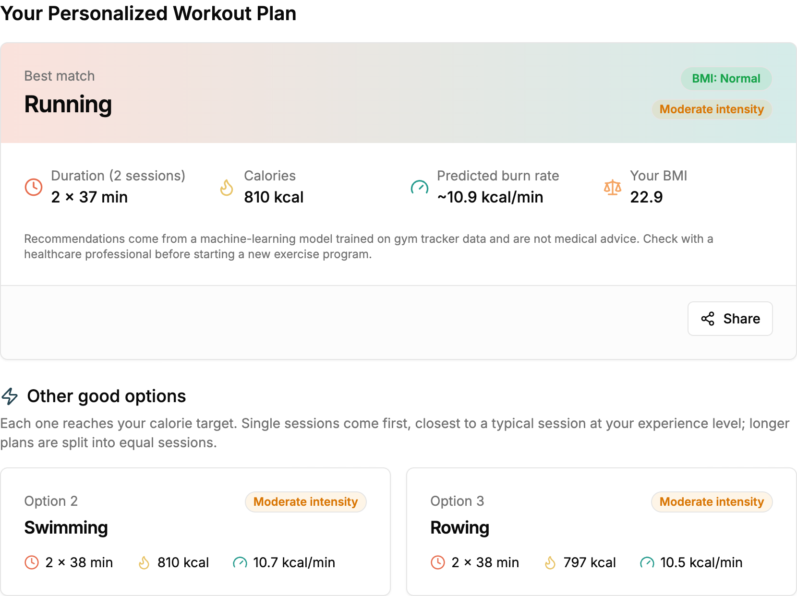

# Model & Recommendation Logic

This document explains how FitSense-AI turns a user's profile into workout recommendations: the data, the model, how it was evaluated, the rules applied on top of it, and its limitations.

Training happens in the [FitInsights](https://github.com/minierks/FitInsights) repository, in the `ImprovedModel.ipynb` notebook. This repository only serves the exported files.

---

## Contents

1. [Why the first version was replaced](#1-why-the-first-version-was-replaced)
2. [Data](#2-data)
3. [The calorie-rate model](#3-the-calorie-rate-model)
4. [Results](#4-results)
5. [From prediction to recommendation](#5-from-prediction-to-recommendation)
6. [Worked examples](#6-worked-examples)
7. [Limitations](#7-limitations)
8. [Retraining and updating the API](#8-retraining-and-updating-the-api)

---

## 1. Why the first version was replaced

The first version (`PredictWorkout.ipynb` in FitInsights) used two Random Forest models on the same inputs (age, weight, BMI, BMI category, gender, experience level, target calories):

- a **classifier** predicting the workout type (14 classes), and
- a **regressor** predicting session duration.

Both were re-evaluated with 5-fold cross-validation and compared against **baselines**: "models" that ignore the inputs and always predict the most common class or the average value.

### Workout type (classification)

| Model | Accuracy | Macro F1 |
|---|---|---|
| Baseline: always the most common workout | 14.5% | 0.02 |
| Logistic Regression | 15.8% | 0.13 |
| **Random Forest (deployed config)** | **18.4%** | 0.15 |
| Gradient Boosting | 18.2% | 0.17 |

No algorithm gets meaningfully above the baseline. The exploratory analysis explains why: people doing each of the 14 workouts have almost the same average age (32–35) and BMI (24.5–25.6). **Body measurements carry almost no information about which workout someone chose**, so no amount of tuning could fix this target.

### Session duration (regression)

| Model | MAE (minutes) | R² |
|---|---|---|
| Baseline: always the mean | 7.8 | 0.00 |
| Ridge (linear) | 4.5 | 0.65 |
| Random Forest (deployed config) | 4.5 | 0.65 |

The duration model did learn something real. But a plain linear model matched the Random Forest, so the relationship is essentially linear (more experience and a bigger calorie target mean a longer session).

### The change

The question was reframed into one the data can answer. The model no longer asks *"which workout did this person choose?"*. It asks:

> **"If this person does workout X, how many calories per minute will they burn?"**

The exploratory analysis supports this. A one-way ANOVA showed calories-per-minute differs strongly by workout type (F = 128, p ≈ 4.5 × 10⁻²³⁹), and burn rate also depends on weight, gender and experience.

---

## 2. Data

| | |
|---|---|
| Source | Kaggle fitness-tracker dataset, cleaned in FitInsights |
| Training file | `fitinsights_data.csv`, **1,629 sessions** |
| Workout types | 14: Aerobics, Boxing, CrossFit, Cycling, HIIT, Pilates, Rowing, Running, Soccer, Strength Training, Swimming, Tennis, Walking, Yoga |
| Session length | 30–70 min (longest: 70.2 min) |
| Calories per session | up to ~806 kcal |

**Cleaning in FitInsights:**
- Fixed misspelled categories (e.g. `Runnng` → `Running`).
- Removed 6 duplicate rows.
- Filled missing numbers with the median and missing categories with the most common value.
- Capped outliers to the IQR range (winsorization) instead of deleting rows.

**Target variable:** `Calories_per_Min = Calories_Burned / (Session_Duration_hours × 60)`.

**BMI fix:** BMI is recomputed as `weight / height²`, the same formula the API uses. The stored BMI column had been capped at 18.5 by the outlier step, which hid 26 underweight users. Recomputing it brings them back and keeps training and serving consistent.

---

## 3. The calorie-rate model

| | |
|---|---|
| Inputs | `Age`, `Weight_kg`, `BMI` (numeric, standardized) · `Gender`, `Experience_Level`, `Workout_Type` (categorical, one-hot encoded) |
| Target | `Calories_per_Min` |
| Algorithm | `HistGradientBoostingRegressor` |
| Tuning | `GridSearchCV`, 5-fold, mean absolute error, over `max_depth` {2, 3, 4} × `learning_rate` {0.03, 0.05, 0.1} × `max_iter` {200, 300, 500} |
| Best parameters | `max_depth=3`, `learning_rate=0.03`, `max_iter=500` |
| Packaging | One scikit-learn `Pipeline` (preprocessing + model) saved with `joblib` as `fitinsight_calorie_rate_model.joblib` (~0.5 MB) |

**Inputs deliberately left out:** heart-rate features (`Avg_BPM`, `Max_BPM`, `Workout_Intensity`, heart-rate reserve) are not used. A new user doesn't know them before working out, so training on them would be **data leakage**: the model would rely on information that isn't available when it's actually used.

**Why one pipeline:** saving preprocessing and model together means the API runs exactly the transformations used in training. Nothing is re-implemented by hand, so there is no train/serve skew.

---

## 4. Results

### Which inputs matter (5-fold cross-validation, linear model)

| Inputs | MAE (kcal/min) | R² |
|---|---|---|
| Workout type only | 1.66 | 0.49 |
| Body + experience only | 1.96 | 0.35 |
| **All inputs** | **0.83** | **0.86** |

Both parts matter. Workout type sets the baseline burn rate and the person's body adjusts it.

### Model comparison (5-fold cross-validation, all inputs)

| Model | MAE (kcal/min) | R² |
|---|---|---|
| Baseline (mean) | 2.41 | 0.00 |
| Ridge (linear) | 0.83 | 0.86 |
| Random Forest | 0.77 | 0.86 |
| **Gradient Boosting** | **0.75** | **0.87** |

Even a linear model reaches R² 0.86, so the result doesn't depend on a complex model. Gradient boosting was chosen for the small extra accuracy.

### Final model on the held-out test set (20%)

| Metric | Value |
|---|---|
| R² | **0.855** |
| MAE | **0.80 kcal/min** (average burn rate is ~9.6 kcal/min) |
| Total-calorie check | Predicted rate × actual session length vs actual calories burned: off by **32 kcal (7.9%)** on average (cross-validated) |

### What drives the prediction (linear-model coefficients, kcal/min)

| Effect | Size |
|---|---|
| HIIT / CrossFit | about **+3.3** |
| Rowing / Swimming / Cycling | about +1.8 to +1.9 |
| Yoga / Pilates | about **−3.3** |
| Walking | about −2.8 |
| Weight (per standard deviation) | about **+1.6** (heavier people burn more for the same activity) |
| Beginner (vs average) | about +0.45 (beginners train shorter but harder relative to their fitness) |

---

## 5. From prediction to recommendation

The model only predicts burn rates. The API turns them into recommendations with a few explicit, documented rules. They live in `recommend_workouts()` in `ml-api/app.py`, and the same logic is in the notebook.

| Step | Rule | Learned from data? |
|---|---|---|
| 1 | Predict kcal/min for all 14 workouts; `minutes = target ÷ rate` | Model |
| 2 | Beginners never get HIIT or CrossFit (average intensity > 80% of max heart rate) | **No:** safety rule. Beginners in the data do every workout type. |
| 3 | Plans longer than 70.2 min (the longest session in the data) are split into equal sessions | Threshold from data |
| 4 | Single-session plans rank first, by closeness to the usual session for the experience level; split plans follow, least total time first | Usual lengths from data |
| 5 | Return the top 3 | — |

**Usual session length by experience level** (median, from `workout_profiles.json`):

| Beginner | Intermediate | Advanced | Professional |
|---|---|---|---|
| 36.6 min | 45.0 min | 58.2 min | 60.6 min |

**Intensity labels** (average heart rate as a share of max, per workout):

| Low (< 0.70) | Moderate (0.70–0.80) | High (≥ 0.80) |
|---|---|---|
| Yoga, Pilates, Walking | Aerobics, Boxing, Soccer, Tennis, Strength Training, Running, Cycling, Rowing, Swimming | HIIT, CrossFit |

**800 kcal limit.** Targets above 800 kcal are rejected, because no session in the data burned more than ~806 kcal. Before this limit existed, every large target returned the same three fastest-burning workouts with impossible durations (e.g. *CrossFit for 126 min*).

---

## 6. Worked examples

25-year-old man, 70 kg, 175 cm:

| Target | Intermediate (usual 45 min) | Beginner (usual 37 min) |
|---|---|---|
| 300 kcal | Walking 50 · Aerobics 37 · Boxing 37 | Aerobics 37 · Boxing 37 · Soccer 36 |
| 500 kcal | HIIT 44 · Swimming 47 · Rowing 48 | Running 46 · Swimming 47 · Cycling 48 |
| 700 kcal | CrossFit 59 · HIIT 61 · Swimming 66 | Running 64 · Swimming 66 · Rowing 67 |
| 800 kcal | CrossFit 67 · HIIT 70 · Swimming **2 × 38** | Running **2 × 37** · Swimming 2 × 38 · Rowing 2 × 38 |

(minutes)

Reading the table:
- Small targets get gentle, moderate-length workouts.
- Larger targets get high-burn workouts that still fit a normal session.
- At the top of the range some plans need two sessions.



---

## 7. Limitations

- **Small dataset.** About 1,600 sessions. Rare groups (26 underweight users, 15 professionals) give less reliable predictions.
- **Similar workouts look the same.** Aerobics, Boxing, Soccer, Tennis and Strength Training have nearly identical burn rates, so they can appear with the same numbers.
- **Large targets have few options.** Between ~600 and 800 kcal the high-burn workouts usually win, because they're the only ones that fit the target into a normal session.
- **Rules aren't learned.** The beginner rule and the 800 kcal limit are design decisions.
- **The recommender itself isn't evaluated.** The burn-rate model is measured, but whether users like or follow the recommendations needs real feedback data.
- **`expected_calorie_burn` lands near the target by design**, because the minutes are computed from the target. The real predictions are the burn rate and the minutes.

---

## 8. Retraining and updating the API

1. In FitInsights, run `ImprovedModel.ipynb` top to bottom. Use scikit-learn **1.9.1**, the version pinned in `ml-api/requirements.txt`; pickled models are only guaranteed to load in the same version.
2. Copy the two outputs into this repo:
   ```bash
   cp ../FitInsights/fitinsight_calorie_rate_model.joblib ../FitInsights/workout_profiles.json ml-api/
   ```
3. Run `pytest` in `ml-api/`, then redeploy the API (see [deployment.md](deployment.md)).
4. If the scikit-learn version changes, update the pin in `requirements.txt` at the same time, and change `MODEL_VERSION` in `app.py` whenever the model changes.
